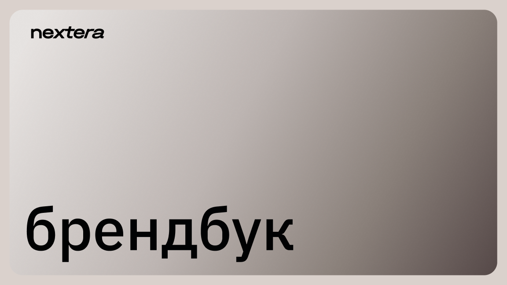
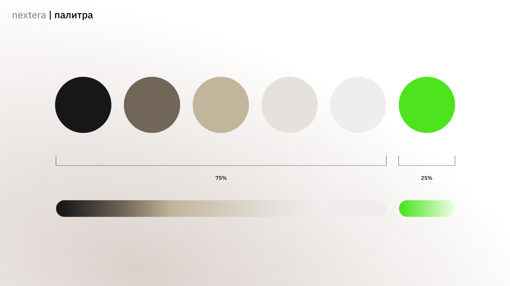

# Брендбук Nextera — текстом

Пересказ страницы `guide` файла Figma [NexteraBrandBook](https://www.figma.com/design/KCfG4o42G1dTIOesBKcvUn/NexteraBrandBook) с цитатами. Картинка каждого кадра — в папке `guide/`. При расхождении текста и Figma верна Figma.

## 1. Бренд и позиционирование

**Задача бренда** ([кадр](guide/02-ambition.png)):
- бренд для ИИ-платформы, кардинально меняющей стандартные принципы ИТ-разработки;
- уникальное название про смену парадигмы;
- умный логотип и визуальный стиль, которые запоминаются и вызывают эмоции и доверие.

**Позиционирование** ([кадр](guide/03-positioning.png)): «nextera — мультиагентная AI-платформа, которая кратно ускоряет создание софта».

**Легенда** ([кадр](guide/05-legend.png)): склейка next + era — «следующая эра». Смена парадигмы разработки в корпорации — от бэклога и команд к FDE-инженерам и управляемому вайбкодингу. Коротко: «Новая эра корпоративного ИТ». Плюсы имени: уникальный неологизм, понятно и легко запомнить, свободный домен nextera.ru.

**Ключевые смыслы** ([кадр](guide/04-key-messages.png)):
- *Платформа и ценность.* «NEXTERA позволяет использовать вайбкодинг не точечно, а на уровне всей корпорации».
- *Как это работает.* Вместо одиночных энтузиастов — усиленная ИТ-команда: разработчики становятся FDE-инженерами и работают с ИИ-агентами. Платформа обеспечивает безопасность и хранение данных, корпоративные правила разработки, среду исполнения и единое ядро для работы с LLM.
- *Что меняется для бизнеса.* «Без платформы вайбкодинг остаётся экспериментом отдельных разработчиков. С платформой он превращается в управляемый производственный конвейер, на котором можно безопасно запускать проекты в пром».

**Процессы — в основе** ([кадр](guide/10-process.png)): требование → анализ → разработка → релиз → ретроспектива → новые требования. Классические шесть этапов берёт на себя FDE-инженер с системой ИИ-агентов.

## 2. Характер и голос

**Характерные черты платформы** ([кадр](guide/06-platform-traits.png)):

| Черта | Что значит |
|---|---|
| инфраструктурный | не инструмент, а основа среды |
| интегрирующий | соединяет бизнес, ИТ, процессы и знания |
| архитектурный | мыслит связями, уровнями, зависимостями |
| самообучающийся | накапливает и использует опыт |
| детерминированный | предсказуемое поведение (важно для enterprise) |
| антихаотичный | устраняет разрозненность и Shadow AI |
| масштабируемый | работает при росте без деградации |
| технологически глубокий | не поверхностное решение, а глубинная платформа |

**Архетипы** ([кадр](guide/07-archetypes.png)):
- основной — **Правитель**: контроль, управление сложностью, стандарты, порядок; продаёт продукт CIO/CEO;
- вторичный — **Бунтарь**, но системный, не анархист: не принимает текущий хаос AI, говорит «так больше нельзя», предлагает новую модель; даёт энергию и отличие;
- тонкий слой — **Творец**: создаёт новую категорию, проектирует процессы, мыслит как архитектор.

**Формула и тон** ([кадр](guide/08-formula-tov.png)): «Контроль, который переопределяет правила» = Правитель × Бунтарь (через Творца). Правитель даёт доверие, Бунтарь — интерес, Творец — глубину. Убираем любого — всё разваливается: без Правителя — стартап «на хайпе», без Бунтаря — скучный корпоратив, без Творца — нет новой категории.

| Так звучит Nextera | Так не должно быть |
|---|---|
| «AI-разработка в компаниях вышла из-под контроля» | «мы поможем вам» — слабая позиция |
| «инструменты не масштабируются» | «AI изменит мир» — банально |
| «скорость без системы — это риск» | «удобный инструмент» — мы не про инструмент |
| «мы возвращаем контроль» | |

**Итоговая формулировка** ([кадр](guide/09-platform-statement.png)): «nextera — это не AI-инструмент. Это корпоративная система, которая делает разработку управляемой, масштабируемой и обучающейся».

## 3. Логотип

| | |
|---|---|
| Символ-«бусины» — [кадр](guide/14-logo-symbol.png), файл `logo/symbol.svg` | Знак и материал — [кадр](guide/11-sign.png), [кадр](guide/12-sign-material.png): инновационность, гибкость, единая структура, взаимодействие элементов, любые формы |
| Латиница — [кадр](guide/15-logo-latin.png), `logo/latin.svg` | Кириллица «некстера» — [кадр](guide/16-logo-cyrillic.png), `logo/cyrillic.svg` |
| Горизонтальная версия — [кадр](guide/17-logo-horizontal.png) | Дескриптор, построения, охранное поле «x», монохром — [кадр](guide/18-logo-descriptor-safezone.png), `logo/descriptor-ink.svg`, `logo/descriptor-paper.svg` |
| Материал знака — [кадр](guide/19-logo-material.png), `graphics/material-1.png` | Раскадровка анимации — [кадр](guide/13-animation-storyboard.png) |

**Как нельзя** ([кадр](guide/20-logo-donts.png)): деформировать, поворачивать, менять цвет, ставить на цветную подложку, заменять буквы другими знаками, ставить с низким контрастом.

## 4. Шрифты

**Halvar** — шрифт логотипа ([кадр](guide/21-font-halvar.png)): «индустриальный» шрифт с чёткими ритмами и минималистичной геометрией, вдохновлён машиностроением. Гротеск даёт преемственность ИТ-сфере; нарастающий наклон дополняет динамику знака слева направо и поддерживает вектор процессов. В текстах не используется, логотип — только контурами.

**IBM Plex Sans** — шрифт всех текстов. Заголовки — всегда со строчной: «мы общаемся на равных» ([кадр](guide/29-layout-system.png)).

## 5. Палитра

75 % нейтральные / 25 % акцент. Значения и роли — `tokens/colors.json`; сверены с Figma скриптом `scripts/export_from_figma.py`.

## 6. Графика

- **Сетка** — [кадр](guide/23-graphics-grid.png).
- **Формы** из «бусин» — [кадр](guide/24-graphics-forms.png), файл `graphics/forms.svg`.
- **Как рисуем** — [кадр](guide/26-graphics-how-we-draw.png): две сферы сливаются в форму знака.
- **Баннер** — [кадр](guide/25-graphics-banner.png). **Посты** — [кадр](guide/27-graphics-posts.png).
- **Сайт** — [кадр](guide/28-graphics-site.png); полные макеты страницы `web` — `web/01-site-desktop.png`, `web/02-site-desktop-v2.png`, `web/03-site-mobile.png`.

**Система вёрстки** ([кадр](guide/29-layout-system.png)):
- заголовок — «сочный, вкусный, акцент всего носителя, цепляем внимание», всегда со строчной;
- пропорция иерархии — минимум 20 %, заголовочные блоки лучше 30–40 %;
- второй уровень — лид или другая важная информация;
- третий — ссылки, соцсети, технический текст.

## 7. Материалы и мерч

- **Материалы** ([кадр](guide/30-materials.png)): металлик, матовое стекло, пластик софт-тач — всегда с тёплым освещением.
- **Мерч** ([кадр](guide/31-merch.png)): брелок-медальон, браслет из «бусин», одежда.

## 8. Кейс бренда

Страница `case` — кейс разработки бренда: `case/nextera-case-full.png` целиком, соцформаты — `case/story-*.png` (1080×1920), `case/post-*.png` (1200×1600).
